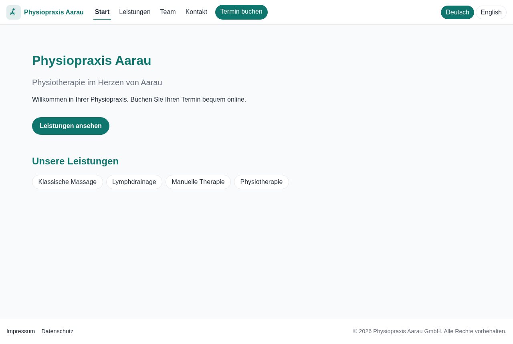
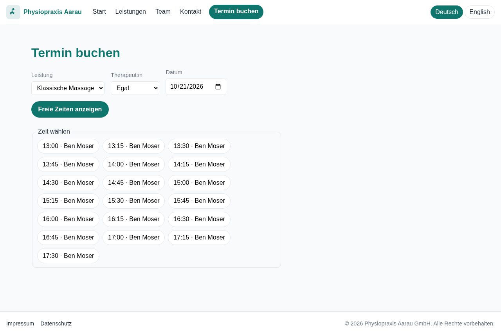
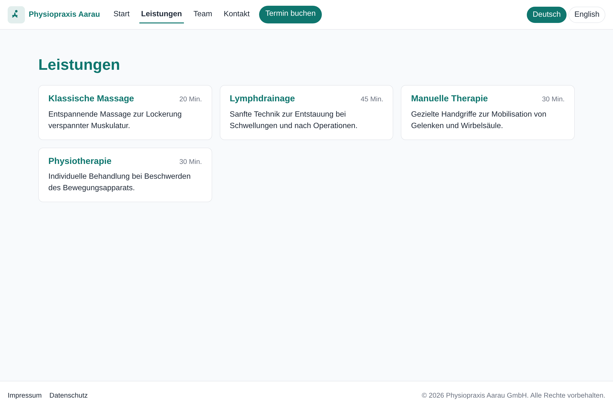
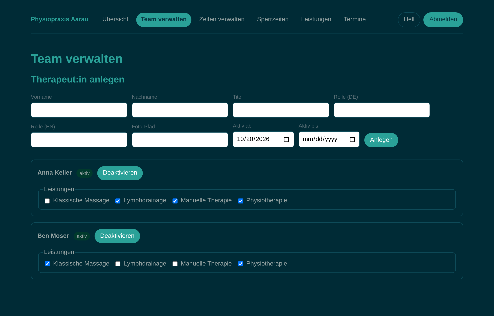
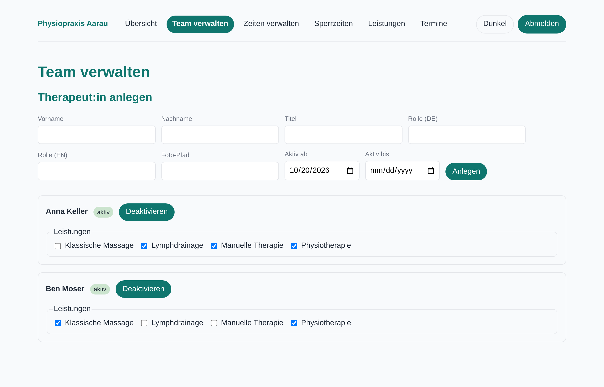
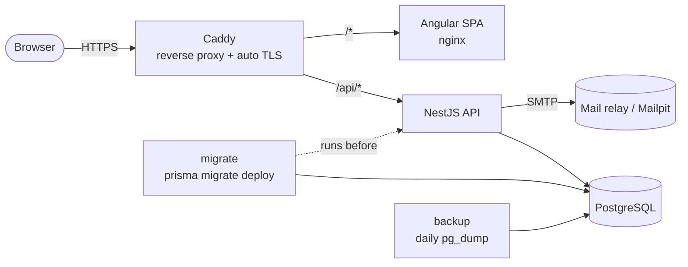
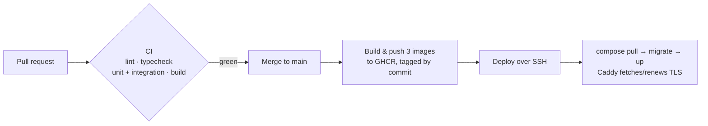

# praxis-buchung

[](https://github.com/selemontewelde/praxis-buchung/actions/workflows/ci.yml)

Configurable website with online appointment booking for a single physiotherapy
practice. A new practice is launched by editing a config file (name, colours, logo,
contact, legal) — no code changes. Built as a reusable template and as a fullstack +
DevOps portfolio reference.

> Status: in active development. See the [GitHub issues](https://github.com/selemontewelde/praxis-buchung/issues) and milestones for progress.

## Live demo

No permanent public instance runs by default — this is a template and portfolio
reference, not a hosted service. The stack is **deploy-on-demand**: a merge to
`main` builds and publishes the images, and pointing the pipeline at any server
(set the deploy secrets and `DEPLOY_ENABLED=true`) brings up the full stack with
automatic HTTPS in minutes. See [Deployment](#deployment) and
[ADR-0009](docs/adr/0009-deployment-ghcr-ssh-compose-migrator.md). A live instance
can be provisioned on request; the [screenshots](#screenshots) above show the
running app end to end.

## Screenshots

The public site is light and themed from the practice config:

| Home | Online booking | Services |
| --- | --- | --- |
| [](docs/screenshots/home.png) | [](docs/screenshots/booking.png) | [](docs/screenshots/services.png) |

The admin back office is a separate **Solarized cockpit** with a light/dark
toggle. The same pages re-skin entirely through CSS custom-property inheritance —
the shell redefines the colour tokens once and every admin view follows:

| Admin cockpit — dark | Admin cockpit — light |
| --- | --- |
| [](docs/screenshots/admin.png) | [](docs/screenshots/admin-light.png) |

Everything above is rendered from the single practice config and the seeded demo
practice — a new practice changes only `config/practice.config.ts`.

## Tech stack

| Layer      | Choice                                                        |
| ---------- | ------------------------------------------------------------- |
| Frontend   | Angular 22 (standalone, signals, zoneless), custom CSS        |
| Backend    | NestJS 12 (REST), input validation, `/health` endpoint        |
| Database   | PostgreSQL + Prisma (migrations, seed data)                   |
| Email      | Mailpit locally, SMTP via env in staging/production           |
| Tests      | Vitest (unit), Playwright (E2E booking)                       |
| Infra      | Docker Compose, multi-stage Dockerfiles, Caddy, GitHub Actions |

## Monorepo layout

```
.
├── frontend/   # Angular app
├── backend/    # NestJS API
├── config/     # the single practice config (branding, contact, legal + demo seed)
├── infra/      # production Dockerfiles, compose, Caddyfile, backup script
├── docs/       # PRD, ADRs, screenshots, agent docs
├── docker-compose.yml  # local dev stack
└── package.json        # npm workspaces root (scripts fan out to both apps)
```

## Architecture

At runtime, Caddy is the only service exposed to the internet; it terminates TLS
and routes to the Angular SPA (served by nginx) and the NestJS API. A one-off
`migrate` job applies pending migrations before the API starts, and a `backup`
sidecar dumps the database daily.



A merge to `main` goes green → images → server, with no manual build on the box:



## Prerequisites

- Node.js 22 (`.nvmrc` pins the version — run `nvm use`)
- npm 10+
- Docker + Docker Compose v2 (for the local stack)

## Getting started

```bash
nvm use          # switch to Node 22
npm install      # installs both workspaces from the repo root
```

## Local stack (Docker Compose)

```bash
cp .env.example .env     # local dev values (gitignored)
docker compose up        # builds and starts the whole stack
```

| Service  | URL / port                      | Notes                          |
| -------- | ------------------------------- | ------------------------------ |
| Frontend | http://localhost:4200           | Angular dev server             |
| Backend  | http://localhost:3000           | NestJS API                     |
| Health   | http://localhost:3000/health    | 200 + DB connectivity, else 503 |
| Postgres | localhost:5432                  | user/pass/db from `.env`       |
| Mailpit  | http://localhost:8025           | mail UI; SMTP on 1025          |

Ports are configurable via `.env`. Stop with `docker compose down` (add `-v` to
also drop the Postgres volume).

> **Upgrading from an older Postgres volume:** the stack runs Postgres 18, which
> stores its data under `PGDATA=/var/lib/postgresql/data/pgdata` (see
> `docker-compose.yml`). A volume created by an earlier major (e.g. 17), or one
> written before that `PGDATA` was set, won't start under 18. On a dev machine,
> reset it with `docker compose down -v` and re-seed; for data worth keeping,
> dump with the old image first, then restore (see
> [Backups & restore](#backups--restore)).

## Database (Prisma)

The schema lives in `backend/prisma/schema.prisma`; the SQL migrations in
`backend/prisma/migrations/` are committed. On Prisma 7 the connection URL is read
from `backend/prisma.config.ts` (migrations) and from a driver adapter at runtime,
not from the schema. The Prisma client is generated into `backend/src/generated/`
on every install (`postinstall`) and is gitignored.

Run against the local stack (Postgres must be up). `DATABASE_URL` comes from `.env`:

```bash
# from the repo root; commands target the backend workspace
npm run prisma:migrate --workspace backend          # create & apply a dev migration
npm run prisma:migrate:deploy --workspace backend    # apply existing migrations (CI/prod)
npm run db:seed --workspace backend                  # seed the demo practice from config
npm run prisma:studio --workspace backend            # browse data in Prisma Studio
```

## Logging

The backend logs with [pino](https://getpino.io) via `nestjs-pino` (structured
JSON). Each HTTP request gets a correlation id (`x-request-id`, reused from an
inbound header or generated) that tags every log line of that request and is
echoed on the response. Personal data (name, email, phone) and secrets (auth
header, cookies, passwords) are redacted. The format follows `NODE_ENV` — pretty
in development, raw JSON everywhere else — and the verbosity is set by
`LOG_LEVEL` (default `info`). See `backend/src/logging/`.

## Configuration

A practice is launched by editing **one file**: [`config/practice.config.ts`](config/practice.config.ts)
(typed by `config/practice-config.types.ts`, with invariants checked by
`config/practice-config.validation.ts`). It has two parts, per
[ADR-0001](docs/adr/0001-config-seeds-db-is-source-of-truth.md):

- **Presentation** — `branding`, `contact`, `legal` — drives the public website.
- **Seed** — `therapists`, `services`, `capabilities`, opening/working hours — the initial
  operational data loaded into the database by `npm run db:seed`. After seeding, the
  **database** is the source of truth and this data is edited in the admin, never by
  changing the file. Entities are referenced by a human-readable `key` that doubles as
  their database id, so re-seeding is idempotent.

## Scripts (run from the repo root)

| Command                 | What it does                                   |
| ----------------------- | ---------------------------------------------- |
| `npm run lint`          | Lint both apps                                 |
| `npm run typecheck`     | Type-check both apps (`tsc --noEmit`)          |
| `npm test`              | Run unit tests in both apps                    |
| `npm run build`         | Production build of both apps                  |
| `npm run start:frontend`| Serve the Angular dev server                   |
| `npm run start:backend` | Run the NestJS API in watch mode               |

## End-to-end booking test

A [Playwright](https://playwright.dev) smoke test (`frontend/e2e/booking.spec.ts`)
drives the whole booking flow through the real UI and API against the seeded demo
practice. CI runs it on every PR via the `E2E` workflow (`.github/workflows/e2e.yml`) —
informational, so a failure surfaces without blocking the merge. To run it against
your local stack:

```bash
# 1. Start the stack and seed the demo practice (DATABASE_URL from your .env).
docker compose up -d
npm run db:seed --workspace backend

# 2. Install the browser once.
cd frontend && npx playwright install chromium && cd ..

# 3. Run the test.
npm run e2e --workspace frontend
```

## Backups & restore

In production (`infra/compose.prod.yml`) a `backup` service dumps the database
once a day and keeps the recent dumps:

- **What:** `pg_dump` of the whole database, gzipped, written to `./backups/` next
  to the compose file on the server as `backup-<timestamp>.sql.gz`.
- **When / retention:** daily at `BACKUP_HOUR` (default `03:00`, in `TZ`), keeping
  `BACKUP_RETENTION_DAYS` days (default `7`). See `infra/.env.prod.example`.
- **On demand:** `docker compose -f compose.prod.yml exec backup sh /backup.sh once`.
- Copy `./backups/` **offsite** periodically (e.g. `scp` or object storage) — the
  on-server copy alone does not survive losing the server.
- **Dumps contain personal data** (patient names and contact details). Under the
  revDSG, keep them access-controlled and encrypted at rest, and delete offsite
  copies on the same retention schedule.

### Restore a backup

Run on the server, from the directory holding `compose.prod.yml` and `.env`.

```bash
# 0. Load the DB name/user/password from .env into this shell.
set -a; . ./.env; set +a

# 1. Pick a dump.
ls -1 backups/

# 2. Stop everything that writes (app + the backup job), keep Postgres running.
docker compose -f compose.prod.yml stop backend frontend caddy backup

# 3. Drop and recreate the database, then load the dump into it.
docker compose -f compose.prod.yml exec -T postgres \
  psql -U "$POSTGRES_USER" -d postgres \
  -c "DROP DATABASE IF EXISTS \"$POSTGRES_DB\";" -c "CREATE DATABASE \"$POSTGRES_DB\";"
gunzip -c backups/backup-<timestamp>.sql.gz | \
  docker compose -f compose.prod.yml exec -T postgres psql -U "$POSTGRES_USER" -d "$POSTGRES_DB"

# 4. Bring the app back up (the migrate service re-checks the schema first).
docker compose -f compose.prod.yml up -d
```

To inspect a dump without restoring: `gunzip -c backups/backup-<timestamp>.sql.gz | less`.

## Deployment

Deployment is automated from `main` and configured entirely under `infra/`:

- **Images** — on merge to `main`, CI builds and pushes the `backend`, `frontend`
  and `migrate` images to GHCR, tagged `latest` and `sha-<commit>`.
- **Server** — the `deploy` job copies `infra/compose.prod.yml` + `Caddyfile` +
  `backup.sh` to the server and runs `docker compose pull && up -d`. It stays
  dormant until the repo variable `DEPLOY_ENABLED` is `true` and the SSH / domain
  secrets exist, so `main` is green long before a server is provisioned.
- **Migrations** run as a one-off `migrate` service before the backend starts.
- **HTTPS** is automatic via Caddy (Let's Encrypt for a real domain).
- **Config** — every production variable is documented in
  [`infra/.env.prod.example`](infra/.env.prod.example).

Rationale and trade-offs: [ADR-0009](docs/adr/0009-deployment-ghcr-ssh-compose-migrator.md).

### Rollback

Every deploy publishes immutable `sha-<commit>` images, so a bad release is
undone by **redeploying the previous one — not by rebuilding old code**. Run the
**Rollback** workflow (`Actions → Rollback → Run workflow`) with the target
`image_tag` (e.g. `sha-abc1234`, from the target commit's _Publish images to
GHCR_ run). It verifies the images exist in GHCR, then repulls that tag and
restarts the stack over SSH — the same mechanics as the deploy job. Like deploy,
it is dormant until `DEPLOY_ENABLED` is `true`.

> **Rollback covers application code, not the database schema.** Prisma
> migrations are forward-only (`prisma migrate deploy` applies pending ones and
> never reverts), so an older image may run against a newer schema. Design
> migrations to be backward-compatible; a schema change an old release cannot
> tolerate needs a deliberate forward-fix, not a rollback.

### Email (production)

Locally, [Mailpit](http://localhost:8025) catches all mail — no configuration
needed. For a real provider, set in the server `.env`: `SMTP_HOST`, `SMTP_PORT`,
`SMTP_USER`, `SMTP_PASS`, and `MAIL_FROM`. When credentials are set the connection
requires TLS (STARTTLS on port 587, or `SMTP_SECURE=true` for implicit TLS on port
465), so the password is never sent in clear. `SMTP_PASS` is a secret — keep it in
the server `.env`, never in git. See [`infra/.env.prod.example`](infra/.env.prod.example).

## Architecture decisions

Significant, hard-to-reverse decisions are recorded as ADRs in
[`docs/adr/`](docs/adr/):

| ADR | Decision |
| --- | --- |
| [0001](docs/adr/0001-config-seeds-db-is-source-of-truth.md) | Config seeds the database; the DB is the source of truth for operational data |
| [0002](docs/adr/0002-npm-workspaces-with-legacy-peer-deps.md) | A single npm-workspaces monorepo (with `legacy-peer-deps`) |
| [0003](docs/adr/0003-prisma-7-driver-adapter.md) | Prisma 7 with the `pg` driver adapter (no Rust query engine) |
| [0004](docs/adr/0004-practice-config-as-top-level-package.md) | The practice config as a top-level workspace package shared by both apps |
| [0005](docs/adr/0005-signal-based-runtime-i18n.md) | Signal-based runtime i18n (DE/EN) with a compile-time key-parity check |
| [0006](docs/adr/0006-slot-engine-time-model.md) | The slot engine's time model (minute-of-day domain, UTC instants, practice timezone) |
| [0007](docs/adr/0007-double-booking-prevention-exclusion-constraint.md) | Double-booking prevented by a Postgres GiST exclusion constraint |
| [0008](docs/adr/0008-admin-auth-server-side-sessions.md) | Admin auth via server-side sessions in an HTTP-only cookie (not JWT) |
| [0009](docs/adr/0009-deployment-ghcr-ssh-compose-migrator.md) | Deployment: GHCR images, SSH + Compose, a one-off migrator, Caddy for HTTPS |

## License

UNLICENSED — all rights reserved.
